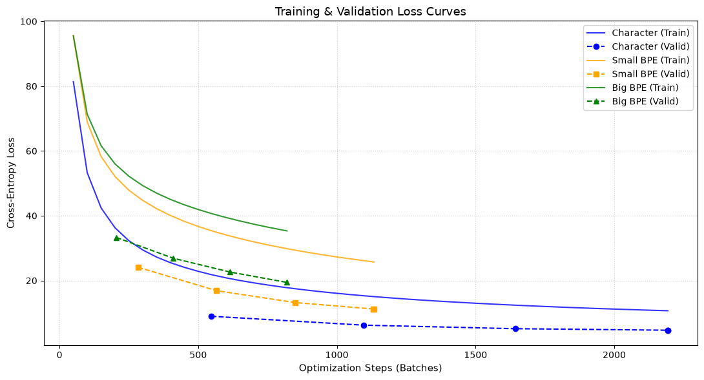
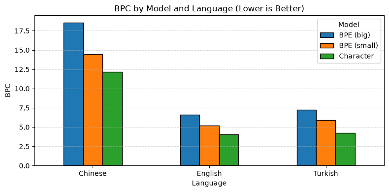

## Part 1: The Tokenizers

### Pre-experiment Predictions

**Which language do you expect to require the most tokens?**
 - Turkish to require the most tokens.
   - Turkish and English both use Latin-based alphabets, but Turkish has _"more productive word morphology"_.
   - Individual Chinese characters are often words on their own.

**How do you expect the larger BPE vocabulary to change the representation of each language?**
 - English — full words or even common short phrases.
 - Turkish — I think it will be the same as English.
 - Chinese — common 2 or more character words and even idioms

**What kinds of units do you expect BPE to learn in English, Turkish, and Chinese?**
 - English — frequently used words (e.g. the, and, a, etc...) and common prefixes and suffixes (e.g. -ing, -er, re-, etc...)
 - Turkish — I think it will be the same as English.
 - Chinese — frequently used characters (e.g. 的，了，个) and common short words.

**Which tokenizer do you expect to work best for language modeling?**
 - I'm guessing the small-sized BPE tokenizer might work best for language modeling.
   - Character-level tokenization will be too slow and inefficient, and making it hard for the model to manage the context.
   - If the BPE vocabulary is too large, there will be a lot more parameters for the model.
   - If the BPE vocabulary is small and compressed at the sweet spot, it is more efficient for the model.


### Pre-experiment Observation

I noticed that the Chinese corpus contains a mixture of traditional and simplified Chinese characters (e.g. 大學 and 大学). Both have the same meaning but would impact the frequencies since they are considered different tokens. This affects evaluations further down the pipeline.

As such, I have decided to do a normalization by converting all the Chinese characters to simplified Chinese characters for the entire dataset.

To run the normalization, run the following command: `uv run ./script/normalize_chinese.py`.


```python
#!uv run ./script/normalize_chinese.py
```

### Imports


```python
import json
import math
import os
import random
from collections import Counter

import matplotlib.pyplot as plt
import pandas as pd
import torch
import torch.nn.functional as F
from IPython.display import Markdown, display
from tokenizers import Tokenizer
from tokenizers.models import BPE
from tokenizers.pre_tokenizers import Whitespace
from tokenizers.trainers import BpeTrainer
from torch.optim.adamw import AdamW
from torch.utils.data import DataLoader
from tqdm import tqdm

from src import (EOS_ID, LANGUAGES, LANGUAGES_LABEL_MAPPING, LOCAL_RUN,
                 RANDOM_SEED, SPECIAL_TOKENS, UNK_ID, UNK_TOKEN,
                 CharacterTokenizer, DecoderTransformer, LMDataset)
```

### Set the Device


```python
# os.environ["CUDA_VISIBLE_DEVICES"] = "1"
os.environ.setdefault("CUDA_VISIBLE_DEVICES", "1")

is_cuda = torch.cuda.is_available()
is_mps = torch.backends.mps.is_available()

if is_cuda:
    DEVICE = torch.device("cuda")
elif is_mps:
    DEVICE = torch.device("mps")
else:
    DEVICE = torch.device("cpu")

print(f"Using device: {DEVICE}")
```

    Using device: mps


### Character-level Tokenizer


```python
tokenizer_directory = './artifact/tokenizer'

os.makedirs(tokenizer_directory, exist_ok=True)


character_tokenizer_file = f'{tokenizer_directory}/character-tokenizer.json'

if os.path.exists(character_tokenizer_file):
    print(f"Tokenizer already exists at {character_tokenizer_file}.")
    character_tokenizer = CharacterTokenizer.from_file(
        character_tokenizer_file
    )
else:
    character_tokenizer = CharacterTokenizer('./data/tokenizer/balanced.txt')
    character_tokenizer.save(character_tokenizer_file)

print(f"Total vocab size: {len(character_tokenizer.vocab):,d}")
print(character_tokenizer.vocab[:10])

print(
    character_tokenizer.encode('hello').ids,
    character_tokenizer.encode('hello').tokens,
    character_tokenizer.decode(character_tokenizer.encode('hello').ids)
)
print(character_tokenizer.encode("✨").ids, UNK_ID)
```

    Total vocab size: 7,648
    ['<UNK>', '<PAD>', '<BOS>', '<EOS>', ' ', '!', '"', '$', '%', '&']
    [68, 65, 72, 72, 75] ['h', 'e', 'l', 'l', 'o'] hello
    [0] 0


### BPE Tokenizer


```python
# %%time
def train_bpe(vocab_size, input_file, output_file):
    if os.path.exists(output_file):
        print(f"Tokenizer already exists at {output_file}. Skip training.")
        return Tokenizer.from_file(output_file)

    tokenizer = Tokenizer(BPE(unk_token=UNK_TOKEN))
    trainer = BpeTrainer(
        special_tokens=SPECIAL_TOKENS,
        vocab_size=vocab_size,
        show_progress=False
    )
    tokenizer.pre_tokenizer = Whitespace()
    tokenizer.train([input_file], trainer)
    tokenizer.save(output_file)
    return tokenizer
```


```python
bpe_tokenizer_small = train_bpe(
    10000, './data/tokenizer/balanced.txt', f'{tokenizer_directory}/bpe-tokenizer-small.json')
bpe_tokenizer_big = train_bpe(
    38500, './data/tokenizer/balanced.txt', f'{tokenizer_directory}/bpe-tokenizer-big.json')

print(f"Small tokenizer's size: {bpe_tokenizer_small.get_vocab_size():,d}")
print(f"Big tokenizer's size: {bpe_tokenizer_big.get_vocab_size():,d}")
```

    Small tokenizer's size: 10,000
    Big tokenizer's size: 38,500


#### Reason for BPE Vocabulary Sizes

I have chosen the vocabulary sizes of 10,000 for the small and 38,500 for the big.

##### Why 10,000 for small?

The training corpus contains $7,648$ unique characters across all languages. Therefore, the minimum vocabulary size is $7,648$. I have chosen 10,000 so that a modest amount of merges ($10,000 - 7,648 = 2,352$) can be performed on the most frequent sub-words.

##### Why 38,500 for big?

I take $7,648 \times 5$ which is $\approx 38,500$. This allows for a large amount of merges ($38,500 - 7,648 = 30,852$) to be performed, which will result in full words being merged as tokens.

#### Analyze the Tokenizers


```python
def load_dataset(type):
    dataset = {}
    random.seed(RANDOM_SEED)
    sample_size = 1000 if LOCAL_RUN else None

    for language in LANGUAGES:
        with open(f'./data/{type}/{language}.txt', 'r', encoding='utf-8') as f:
            lines = [line.strip() for line in f]

            if LOCAL_RUN:
                lines = random.sample(lines, min(len(lines), sample_size))

            dataset[language] = lines

    return dataset


valid_dataset = load_dataset("valid")

tokenizers = {
    "Character Tokenizer": character_tokenizer,
    "BPE Tokenizer (small)": bpe_tokenizer_small,
    "BPE Tokenizer (big)": bpe_tokenizer_big,
}

data = []
for tokenizer_name, tokenizer in tokenizers.items():
    vocab_size = tokenizer.get_vocab_size()

    for language, lines in valid_dataset.items():
        encoded = tokenizer.encode_batch(lines)
        all_token_ids = [
            token_id for encoding in encoded for token_id in encoding.ids
        ]

        total_tokens = len(all_token_ids)
        unique_tokens = len(set(all_token_ids))
        total_characters = sum(len(line) for line in lines)
        total_unk = sum(1 for token_id in all_token_ids if token_id == UNK_ID)

        data.append({
            "Tokenizer": tokenizer_name,
            "Language": LANGUAGES_LABEL_MAPPING[language],
            "Vocabulary Size": vocab_size,
            "Total Tokens": total_tokens,
            "Unique Tokens": unique_tokens,
            "Tokens/Sentence": total_tokens / len(lines),
            "Characters/Token": total_characters / total_tokens,
            "Total Characters": total_characters,
            "Total UNK": total_unk,
            "UNK Rate": total_unk/total_tokens,
        })

df = pd.DataFrame(data)
df.to_json(
    f"{tokenizer_directory}/tokenizer_metrics.json",
    orient="records",
    indent=2
)

df.style.format({
    "Vocabulary Size": "{:,d}",
    "Total Tokens": "{:,d}",
    "Unique Tokens": "{:,d}",
    "Tokens/Sentence": "{:.2f}",
    "Characters/Token": "{:.2f}",
    "Total Characters": "{:,d}",
    "Total UNK": "{:,d}",
    "UNK Rate": "{:.2%}",
})
```


<style type="text/css">
</style>
<table id="T_046de">
  <thead>
    <tr>
      <th class="blank level0" >&nbsp;</th>
      <th id="T_046de_level0_col0" class="col_heading level0 col0" >Tokenizer</th>
      <th id="T_046de_level0_col1" class="col_heading level0 col1" >Language</th>
      <th id="T_046de_level0_col2" class="col_heading level0 col2" >Vocabulary Size</th>
      <th id="T_046de_level0_col3" class="col_heading level0 col3" >Total Tokens</th>
      <th id="T_046de_level0_col4" class="col_heading level0 col4" >Unique Tokens</th>
      <th id="T_046de_level0_col5" class="col_heading level0 col5" >Tokens/Sentence</th>
      <th id="T_046de_level0_col6" class="col_heading level0 col6" >Characters/Token</th>
      <th id="T_046de_level0_col7" class="col_heading level0 col7" >Total Characters</th>
      <th id="T_046de_level0_col8" class="col_heading level0 col8" >Total UNK</th>
      <th id="T_046de_level0_col9" class="col_heading level0 col9" >UNK Rate</th>
    </tr>
  </thead>
  <tbody>
    <tr>
      <th id="T_046de_level0_row0" class="row_heading level0 row0" >0</th>
      <td id="T_046de_row0_col0" class="data row0 col0" >Character Tokenizer</td>
      <td id="T_046de_row0_col1" class="data row0 col1" >English</td>
      <td id="T_046de_row0_col2" class="data row0 col2" >7,648</td>
      <td id="T_046de_row0_col3" class="data row0 col3" >368,269</td>
      <td id="T_046de_row0_col4" class="data row0 col4" >187</td>
      <td id="T_046de_row0_col5" class="data row0 col5" >81.12</td>
      <td id="T_046de_row0_col6" class="data row0 col6" >1.00</td>
      <td id="T_046de_row0_col7" class="data row0 col7" >368,269</td>
      <td id="T_046de_row0_col8" class="data row0 col8" >54</td>
      <td id="T_046de_row0_col9" class="data row0 col9" >0.01%</td>
    </tr>
    <tr>
      <th id="T_046de_level0_row1" class="row_heading level0 row1" >1</th>
      <td id="T_046de_row1_col0" class="data row1 col0" >Character Tokenizer</td>
      <td id="T_046de_row1_col1" class="data row1 col1" >Turkish</td>
      <td id="T_046de_row1_col2" class="data row1 col2" >7,648</td>
      <td id="T_046de_row1_col3" class="data row1 col3" >368,383</td>
      <td id="T_046de_row1_col4" class="data row1 col4" >221</td>
      <td id="T_046de_row1_col5" class="data row1 col5" >98.63</td>
      <td id="T_046de_row1_col6" class="data row1 col6" >1.00</td>
      <td id="T_046de_row1_col7" class="data row1 col7" >368,383</td>
      <td id="T_046de_row1_col8" class="data row1 col8" >15</td>
      <td id="T_046de_row1_col9" class="data row1 col9" >0.00%</td>
    </tr>
    <tr>
      <th id="T_046de_level0_row2" class="row_heading level0 row2" >2</th>
      <td id="T_046de_row2_col0" class="data row2 col0" >Character Tokenizer</td>
      <td id="T_046de_row2_col1" class="data row2 col1" >Chinese</td>
      <td id="T_046de_row2_col2" class="data row2 col2" >7,648</td>
      <td id="T_046de_row2_col3" class="data row2 col3" >368,266</td>
      <td id="T_046de_row2_col4" class="data row2 col4" >4,526</td>
      <td id="T_046de_row2_col5" class="data row2 col5" >38.55</td>
      <td id="T_046de_row2_col6" class="data row2 col6" >1.00</td>
      <td id="T_046de_row2_col7" class="data row2 col7" >368,266</td>
      <td id="T_046de_row2_col8" class="data row2 col8" >208</td>
      <td id="T_046de_row2_col9" class="data row2 col9" >0.06%</td>
    </tr>
    <tr>
      <th id="T_046de_level0_row3" class="row_heading level0 row3" >3</th>
      <td id="T_046de_row3_col0" class="data row3 col0" >BPE Tokenizer (small)</td>
      <td id="T_046de_row3_col1" class="data row3 col1" >English</td>
      <td id="T_046de_row3_col2" class="data row3 col2" >10,000</td>
      <td id="T_046de_row3_col3" class="data row3 col3" >131,384</td>
      <td id="T_046de_row3_col4" class="data row3 col4" >1,450</td>
      <td id="T_046de_row3_col5" class="data row3 col5" >28.94</td>
      <td id="T_046de_row3_col6" class="data row3 col6" >2.80</td>
      <td id="T_046de_row3_col7" class="data row3 col7" >368,269</td>
      <td id="T_046de_row3_col8" class="data row3 col8" >54</td>
      <td id="T_046de_row3_col9" class="data row3 col9" >0.04%</td>
    </tr>
    <tr>
      <th id="T_046de_level0_row4" class="row_heading level0 row4" >4</th>
      <td id="T_046de_row4_col0" class="data row4 col0" >BPE Tokenizer (small)</td>
      <td id="T_046de_row4_col1" class="data row4 col1" >Turkish</td>
      <td id="T_046de_row4_col2" class="data row4 col2" >10,000</td>
      <td id="T_046de_row4_col3" class="data row4 col3" >131,597</td>
      <td id="T_046de_row4_col4" class="data row4 col4" >1,752</td>
      <td id="T_046de_row4_col5" class="data row4 col5" >35.23</td>
      <td id="T_046de_row4_col6" class="data row4 col6" >2.80</td>
      <td id="T_046de_row4_col7" class="data row4 col7" >368,383</td>
      <td id="T_046de_row4_col8" class="data row4 col8" >15</td>
      <td id="T_046de_row4_col9" class="data row4 col9" >0.01%</td>
    </tr>
    <tr>
      <th id="T_046de_level0_row5" class="row_heading level0 row5" >5</th>
      <td id="T_046de_row5_col0" class="data row5 col0" >BPE Tokenizer (small)</td>
      <td id="T_046de_row5_col1" class="data row5 col1" >Chinese</td>
      <td id="T_046de_row5_col2" class="data row5 col2" >10,000</td>
      <td id="T_046de_row5_col3" class="data row5 col3" >301,287</td>
      <td id="T_046de_row5_col4" class="data row5 col4" >6,020</td>
      <td id="T_046de_row5_col5" class="data row5 col5" >31.54</td>
      <td id="T_046de_row5_col6" class="data row5 col6" >1.22</td>
      <td id="T_046de_row5_col7" class="data row5 col7" >368,266</td>
      <td id="T_046de_row5_col8" class="data row5 col8" >208</td>
      <td id="T_046de_row5_col9" class="data row5 col9" >0.07%</td>
    </tr>
    <tr>
      <th id="T_046de_level0_row6" class="row_heading level0 row6" >6</th>
      <td id="T_046de_row6_col0" class="data row6 col0" >BPE Tokenizer (big)</td>
      <td id="T_046de_row6_col1" class="data row6 col1" >English</td>
      <td id="T_046de_row6_col2" class="data row6 col2" >38,500</td>
      <td id="T_046de_row6_col3" class="data row6 col3" >91,195</td>
      <td id="T_046de_row6_col4" class="data row6 col4" >8,462</td>
      <td id="T_046de_row6_col5" class="data row6 col5" >20.09</td>
      <td id="T_046de_row6_col6" class="data row6 col6" >4.04</td>
      <td id="T_046de_row6_col7" class="data row6 col7" >368,269</td>
      <td id="T_046de_row6_col8" class="data row6 col8" >54</td>
      <td id="T_046de_row6_col9" class="data row6 col9" >0.06%</td>
    </tr>
    <tr>
      <th id="T_046de_level0_row7" class="row_heading level0 row7" >7</th>
      <td id="T_046de_row7_col0" class="data row7 col0" >BPE Tokenizer (big)</td>
      <td id="T_046de_row7_col1" class="data row7 col1" >Turkish</td>
      <td id="T_046de_row7_col2" class="data row7 col2" >38,500</td>
      <td id="T_046de_row7_col3" class="data row7 col3" >86,829</td>
      <td id="T_046de_row7_col4" class="data row7 col4" >9,955</td>
      <td id="T_046de_row7_col5" class="data row7 col5" >23.25</td>
      <td id="T_046de_row7_col6" class="data row7 col6" >4.24</td>
      <td id="T_046de_row7_col7" class="data row7 col7" >368,383</td>
      <td id="T_046de_row7_col8" class="data row7 col8" >15</td>
      <td id="T_046de_row7_col9" class="data row7 col9" >0.02%</td>
    </tr>
    <tr>
      <th id="T_046de_level0_row8" class="row_heading level0 row8" >8</th>
      <td id="T_046de_row8_col0" class="data row8 col0" >BPE Tokenizer (big)</td>
      <td id="T_046de_row8_col1" class="data row8 col1" >Chinese</td>
      <td id="T_046de_row8_col2" class="data row8 col2" >38,500</td>
      <td id="T_046de_row8_col3" class="data row8 col3" >229,022</td>
      <td id="T_046de_row8_col4" class="data row8 col4" >19,732</td>
      <td id="T_046de_row8_col5" class="data row8 col5" >23.97</td>
      <td id="T_046de_row8_col6" class="data row8 col6" >1.61</td>
      <td id="T_046de_row8_col7" class="data row8 col7" >368,266</td>
      <td id="T_046de_row8_col8" class="data row8 col8" >208</td>
      <td id="T_046de_row8_col9" class="data row8 col9" >0.09%</td>
    </tr>
  </tbody>
</table>


##### Observations

- With BPE tokenizer, both English and Turkish merge about 3 to 4 characters into a token, while Chinese stays almost as single character per token. This makes sense as Chinese characters are already meaningful words by themselves and they don't require white spaces to separate them.
- With character tokenizer, both English and Turkish have a high average of 80 to 100 tokens per sentence. But with BPE tokenizer, these numbers dropped to approximately 20 tokens per sentence. This allows models to process more information in a single step.
- The UNK rate is very low for all languages across all tokenizers. This indicates that the training data is very sufficient for vocabulary coverage.


```python
random.seed(RANDOM_SEED)

samples = {
    language: random.choice(valid_dataset[language]) for language in LANGUAGES
}

for language, sample in samples.items():
    print('=' * 10, f'{LANGUAGES_LABEL_MAPPING[language].upper()}', '=' * 10)
    print(sample)
    print(f"Character Tokenizer:\n{character_tokenizer.encode(sample).tokens}")
    print(
        f"BPE Tokenizer (small):\n{bpe_tokenizer_small.encode(sample).tokens}"
    )
    print(f"BPE Tokenizer (big):\n{bpe_tokenizer_big.encode(sample).tokens}")
    print('\n', '-' * 50, '\n')
```

    ========== ENGLISH ==========
    Ben arrives at the hotel and kills the employees.
    Character Tokenizer:
    ['B', 'e', 'n', ' ', 'a', 'r', 'r', 'i', 'v', 'e', 's', ' ', 'a', 't', ' ', 't', 'h', 'e', ' ', 'h', 'o', 't', 'e', 'l', ' ', 'a', 'n', 'd', ' ', 'k', 'i', 'l', 'l', 's', ' ', 't', 'h', 'e', ' ', 'e', 'm', 'p', 'l', 'o', 'y', 'e', 'e', 's', '.']
    BPE Tokenizer (small):
    ['B', 'en', 'ar', 'ri', 'ves', 'at', 'the', 'h', 'ot', 'el', 'and', 'kill', 's', 'the', 'em', 'pl', 'o', 'ye', 'es', '.']
    BPE Tokenizer (big):
    ['Ben', 'arri', 'ves', 'at', 'the', 'hotel', 'and', 'kills', 'the', 'employees', '.']
    
     -------------------------------------------------- 
    
    ========== TURKISH ==========
    Çalışma sonuçlarını Dünya üzerinde uygun görülen kurumlara aktarmaktadır.
    Character Tokenizer:
    ['Ç', 'a', 'l', 'ı', 'ş', 'm', 'a', ' ', 's', 'o', 'n', 'u', 'ç', 'l', 'a', 'r', 'ı', 'n', 'ı', ' ', 'D', 'ü', 'n', 'y', 'a', ' ', 'ü', 'z', 'e', 'r', 'i', 'n', 'd', 'e', ' ', 'u', 'y', 'g', 'u', 'n', ' ', 'g', 'ö', 'r', 'ü', 'l', 'e', 'n', ' ', 'k', 'u', 'r', 'u', 'm', 'l', 'a', 'r', 'a', ' ', 'a', 'k', 't', 'a', 'r', 'm', 'a', 'k', 't', 'a', 'd', 'ı', 'r', '.']
    BPE Tokenizer (small):
    ['Ç', 'al', 'ış', 'ma', 'son', 'uç', 'larını', 'D', 'ün', 'ya', 'üzerinde', 'uyg', 'un', 'görül', 'en', 'kur', 'um', 'lara', 'ak', 'tar', 'maktadır', '.']
    BPE Tokenizer (big):
    ['Çalış', 'ma', 'sonuç', 'larını', 'Dünya', 'üzerinde', 'uygun', 'görülen', 'kurum', 'lara', 'aktar', 'maktadır', '.']
    
     -------------------------------------------------- 
    
    ========== CHINESE ==========
    第二波主打歌《夜的第七章》的音乐影片在英国伦敦拍摄，歌词讲述的是福尔摩斯的故事，但影片讲述的是一个普通的侦探故事，
    Character Tokenizer:
    ['第', '二', '波', '主', '打', '歌', '《', '夜', '的', '第', '七', '章', '》', '的', '音', '乐', '影', '片', '在', '英', '国', '伦', '敦', '拍', '摄', '，', '歌', '词', '讲', '述', '的', '是', '福', '尔', '摩', '斯', '的', '故', '事', '，', '但', '影', '片', '讲', '述', '的', '是', '一', '个', '普', '通', '的', '侦', '探', '故', '事', '，']
    BPE Tokenizer (small):
    ['第二', '波', '主', '打', '歌', '《', '夜', '的', '第', '七', '章', '》', '的', '音乐', '影', '片', '在', '英国', '伦', '敦', '拍', '摄', '，', '歌', '词', '讲', '述', '的是', '福', '尔', '摩', '斯', '的', '故事', '，', '但', '影', '片', '讲', '述', '的是', '一个', '普', '通', '的', '侦', '探', '故事', '，']
    BPE Tokenizer (big):
    ['第二', '波', '主打歌', '《', '夜', '的', '第七', '章', '》', '的音乐', '影片', '在英国', '伦敦', '拍摄', '，', '歌词', '讲述', '的是', '福尔', '摩', '斯的', '故事', '，', '但', '影片', '讲述', '的是', '一个', '普通', '的', '侦探', '故事', '，']
    
     -------------------------------------------------- 
    


##### English

In BPE Tokenizer (small), we can see that because of the limited vocabulary size, not enough merges to cater for most of the words. For example, `hotel` is tokenized into `h`, `ot` and `el`. However, this is not the case in BPE Tokenizer (big) where `hotel` is tokenized as a whole. This is because the vocabulary size is large enough to cater for most of the words.

##### Turkish

Same observations as per English.

##### Chinese

For both small and big versions of the BPE Tokenizers, we can see that the Chinese characters merge at 2 to 3 characters, which is again reflected in the metrics (low characters/token) above. This is because Chinese characters are atomic and there are a huge number of them. Common characters that appear together aren't high frequency enough compared to English and Turkish for the BPE algorithm to merge them.

## Part 2: The Language Models

### Prepare the data loaders


```python
train_dataset = {}
for language in LANGUAGES:
    with open(f'./data/train/{language}.txt', 'r', encoding='utf-8') as f:
        train_dataset[language] = [line.strip() for line in f]


def create_data_loader(dataset, tokenizer, type='train', shuffle=True, context_length=128, batch_size=32):
    type_label = 'validation' if type == 'valid' else f'{type}ing'
    is_train = type == 'train'

    data = []

    for sentences in dataset.values():
        data.extend(sentences)

    # for language in LANGUAGES:
    #     with open(f'./data/{type}/{language}.txt', 'r', encoding='utf-8') as f:
    #         data.extend([line.strip() for line in f])

    print(
        f"Total {type_label} sentences across {len(dataset)} languages: {len(data):,d}")
    # print(
    #     f"Total {type_label} sentences across {len(LANGUAGES)} languages: {len(data):,d}"
    # )

    if is_train:
        random.seed(RANDOM_SEED)
        random.shuffle(data)

    print(f"Sample {type_label} data: {data[:10]}")

    encodings = tokenizer.encode_batch(data)
    # print(encodings[0], encodings[0].ids, encodings[0].tokens)
    token_ids = []

    for encoding in encodings:
        token_ids.extend(encoding.ids)
        token_ids.append(EOS_ID)

    print(f"Total {type_label} tokens: {len(token_ids):,d}")

    # print(
    # f"Total {type_label} tokens across {len(LANGUAGES)} languages: {len(token_ids):,d}")

    dataset = LMDataset(
        tokens=torch.tensor(token_ids),
        context_length=context_length
    )
    data_loader = DataLoader(
        dataset=dataset,
        batch_size=batch_size,
        shuffle=is_train
    )

    return data_loader


def get_loaders(label, tokenizer):
    print("=" * 50)
    print("#" * 10, label.upper(), "#" * 10)
    print("-" * 50)
    train_loader = create_data_loader(train_dataset, tokenizer, type="train")
    print()
    valid_loader = create_data_loader(valid_dataset, tokenizer, type="valid")
    print("-" * 50)
    print("=" * 50)
    print()
    return train_loader, valid_loader
```


```python
training_data_loader_char, validation_data_loader_char = get_loaders(
    "Character Tokenizer", character_tokenizer
)
training_data_loader_bpe_small, validation_data_loader_bpe_small = get_loaders(
    "BPE Tokenizer (small)", bpe_tokenizer_small
)
training_data_loader_bpe_big, validation_data_loader_bpe_big = get_loaders(
    "BPE Tokenizer (big)", bpe_tokenizer_big
)
```

    ==================================================
    ########## CHARACTER TOKENIZER ##########
    --------------------------------------------------
    Total training sentences across 3 languages: 142,345
    Sample training data: ['公元前546年，秦景公在位期间，', '主要著述有《滇绎》、《云南大事记》、《滇南金石萃编》、《卧雪堂文集》等 citation 。', '整个牙买加遭受的损失总额约为180万2000美元（1987年美元）。', '，清代与金代发型类似，区别在于金朝为两根辫子。', 'Not much of this wall remains as people have been stealing from it.', "'nın görüşünü alarak otoyollarda otomobiller için hız sınırını 20 km/s arttırmaya yetkilidir.", 'Debussy, 1862-1918）应用半音体系造成极具个人特色的印象派风格与和弦色泽变化。', '） - さいとう・たかを、さいとうプロ（1972年5・6月号） 漫画オリジナルのドルゲ魔人「マンタゲルゲ」「ツノトカゲルゲ」の2体は万创の『とびだすえほん』にも登场する。', 'It is one of the smallest districts.', 'Birleşik Devletler ise bir "savaş alanı" anıtının tarihsel bağlamla tam olarak örtüşmediği kanısındadır.']
    Total training tokens: 8,980,877
    
    Total validation sentences across 3 languages: 17,829
    Sample validation data: ['She played in two matches at this championship.', 'After these victories, he was appointed as the organizing secretary of DMK in southern Tamil Nadu districts.', "In 1536, the Act of Union was passed under Henry's rule which had a long-lasting effect on Wales as a nation.", 'The name comes from Uñi with which the Mapuches (', 'Later in the 1960s, education expanded in West Germany and more universities were founded, but Bochum has a bright selection of subjects because it was the beginning of education expanding.', 'It was filmed and completed in late 1991.', 'Amans and Azoline moved back to France in 1856 where he died in 1888, château de Lévis Saint Nom (78), never having returned to Louisiana.', 'The marriage took place in 1299.', 'The corals will become bleached (lose their colours) and many species that live on and around the reef will be in danger.', 'He wrote many books about political scandals in France.']
    Total validation tokens: 1,122,747
    --------------------------------------------------
    ==================================================
    
    ==================================================
    ########## BPE TOKENIZER (SMALL) ##########
    --------------------------------------------------
    Total training sentences across 3 languages: 142,345
    Sample training data: ['公元前546年，秦景公在位期间，', '主要著述有《滇绎》、《云南大事记》、《滇南金石萃编》、《卧雪堂文集》等 citation 。', '整个牙买加遭受的损失总额约为180万2000美元（1987年美元）。', '，清代与金代发型类似，区别在于金朝为两根辫子。', 'Not much of this wall remains as people have been stealing from it.', "'nın görüşünü alarak otoyollarda otomobiller için hız sınırını 20 km/s arttırmaya yetkilidir.", 'Debussy, 1862-1918）应用半音体系造成极具个人特色的印象派风格与和弦色泽变化。', '） - さいとう・たかを、さいとうプロ（1972年5・6月号） 漫画オリジナルのドルゲ魔人「マンタゲルゲ」「ツノトカゲルゲ」の2体は万创の『とびだすえほん』にも登场する。', 'It is one of the smallest districts.', 'Birleşik Devletler ise bir "savaş alanı" anıtının tarihsel bağlamla tam olarak örtüşmediği kanısındadır.']
    Total training tokens: 4,643,020
    
    Total validation sentences across 3 languages: 17,829
    Sample validation data: ['She played in two matches at this championship.', 'After these victories, he was appointed as the organizing secretary of DMK in southern Tamil Nadu districts.', "In 1536, the Act of Union was passed under Henry's rule which had a long-lasting effect on Wales as a nation.", 'The name comes from Uñi with which the Mapuches (', 'Later in the 1960s, education expanded in West Germany and more universities were founded, but Bochum has a bright selection of subjects because it was the beginning of education expanding.', 'It was filmed and completed in late 1991.', 'Amans and Azoline moved back to France in 1856 where he died in 1888, château de Lévis Saint Nom (78), never having returned to Louisiana.', 'The marriage took place in 1299.', 'The corals will become bleached (lose their colours) and many species that live on and around the reef will be in danger.', 'He wrote many books about political scandals in France.']
    Total validation tokens: 582,097
    --------------------------------------------------
    ==================================================
    
    ==================================================
    ########## BPE TOKENIZER (BIG) ##########
    --------------------------------------------------
    Total training sentences across 3 languages: 142,345
    Sample training data: ['公元前546年，秦景公在位期间，', '主要著述有《滇绎》、《云南大事记》、《滇南金石萃编》、《卧雪堂文集》等 citation 。', '整个牙买加遭受的损失总额约为180万2000美元（1987年美元）。', '，清代与金代发型类似，区别在于金朝为两根辫子。', 'Not much of this wall remains as people have been stealing from it.', "'nın görüşünü alarak otoyollarda otomobiller için hız sınırını 20 km/s arttırmaya yetkilidir.", 'Debussy, 1862-1918）应用半音体系造成极具个人特色的印象派风格与和弦色泽变化。', '） - さいとう・たかを、さいとうプロ（1972年5・6月号） 漫画オリジナルのドルゲ魔人「マンタゲルゲ」「ツノトカゲルゲ」の2体は万创の『とびだすえほん』にも登场する。', 'It is one of the smallest districts.', 'Birleşik Devletler ise bir "savaş alanı" anıtının tarihsel bağlamla tam olarak örtüşmediği kanısındadır.']
    Total training tokens: 3,358,684
    
    Total validation sentences across 3 languages: 17,829
    Sample validation data: ['She played in two matches at this championship.', 'After these victories, he was appointed as the organizing secretary of DMK in southern Tamil Nadu districts.', "In 1536, the Act of Union was passed under Henry's rule which had a long-lasting effect on Wales as a nation.", 'The name comes from Uñi with which the Mapuches (', 'Later in the 1960s, education expanded in West Germany and more universities were founded, but Bochum has a bright selection of subjects because it was the beginning of education expanding.', 'It was filmed and completed in late 1991.', 'Amans and Azoline moved back to France in 1856 where he died in 1888, château de Lévis Saint Nom (78), never having returned to Louisiana.', 'The marriage took place in 1299.', 'The corals will become bleached (lose their colours) and many species that live on and around the reef will be in danger.', 'He wrote many books about political scandals in France.']
    Total validation tokens: 424,875
    --------------------------------------------------
    ==================================================
    


### Training and validation loop


```python
def train_and_validate(tokenizer, training_data_loader, validation_data_loader):
    model = DecoderTransformer(vocabulary_size=tokenizer.get_vocab_size())
    model = model.to(DEVICE)

    optimizer = AdamW(model.parameters(), lr=0.0001)

    training_batches = []
    training_losses = []
    validation_batches = []
    validation_losses = []

    validation_interval = len(training_data_loader) // 4

    NUM_EPOCH = 1

    for epoch in range(NUM_EPOCH):
        model.train()

        running_training_loss = 0.0

        training_progress_bar = tqdm(
            training_data_loader,
            f"[Training] Epoch {epoch + 1} / {NUM_EPOCH}"
        )

        for batch, (x, y) in enumerate(training_progress_bar, 1):
            x = x.to(DEVICE)
            y = y.to(DEVICE)

            optimizer.zero_grad()
            logits = model(x)
            # print(logits.shape, logits.size(2))

            logits_flatten = logits.reshape(-1, logits.size(2))
            targets_flatten = y.reshape(-1)
            # print(targets_flatten.shape, logits_flatten.shape)

            loss = F.cross_entropy(logits_flatten, targets_flatten)
            # print(loss)
            loss.backward()
            optimizer.step()

            running_training_loss += loss.item()
            average_training_loss = running_training_loss / batch
            training_progress_bar.set_postfix(
                batch_loss=f"{loss.item():.4f}", avg_loss=f"{average_training_loss:.4f}")

            if batch % 50 == 0 or batch == len(training_data_loader):
                training_batches.append(batch)
                training_losses.append(average_training_loss)

            if batch % validation_interval == 0 or batch == len(training_data_loader):
                model.eval()
                running_validation_loss = 0.0
                validation_progress_bar = tqdm(
                    validation_data_loader,
                    f"[Validation] Epoch {epoch + 1} / {NUM_EPOCH}"
                )

                with torch.no_grad():
                    for _, (x, y) in enumerate(validation_progress_bar, 1):
                        x, y = x.to(DEVICE), y.to(DEVICE)
                        logits = model(x)
                        logits_flatten = logits.reshape(-1, logits.size(2))
                        targets_flatten = y.reshape(-1)
                        loss = F.cross_entropy(logits_flatten, targets_flatten)

                        running_validation_loss += loss.item()
                        average_validation_loss = running_validation_loss / \
                            len(validation_data_loader)
                        validation_progress_bar.set_postfix(
                            batch_loss=f"{loss.item():.4f}", avg_loss=f"{average_validation_loss:.4f}")

                    validation_batches.append(batch)
                    validation_losses.append(average_validation_loss)

                model.train()

        epoch_training_loss = running_training_loss/len(training_data_loader)
        # training_loss.append(epoch_training_loss)
        # epoch_validation_loss = running_validation_loss / \
        # len(validation_data_loader)
        # validation_loss.append(epoch_validation_loss)

        # print(
        #     f'Average loss for epoch {epoch + 1}: training = {epoch_training_loss:.4f} | validation = {epoch_validation_loss:.4f}\n'
        # )

    metrics = {
        "training_batches": training_batches,
        "training_losses": training_losses,
        "validation_batches": validation_batches,
        "validation_losses": validation_losses
    }

    return model, metrics


def train_validate_and_save(label, name, tokenizer, train_loader, valid_loader):
    print("=" * 50)
    print("#" * 10, label.upper(), "#" * 10)
    print("-" * 50)

    model_path = f"./artifact/model/model_{name}.pth"
    metrics_path = f"./artifact/model/metrics_{name}.json"

    if os.path.exists(model_path) and os.path.exists(metrics_path):
        print(f"Model and metrics already exist for {name}")
        model = DecoderTransformer(
            vocabulary_size=tokenizer.get_vocab_size()
        ).to(DEVICE)
        model.load_state_dict(torch.load(model_path, map_location=DEVICE))
        model.eval()

        with open(metrics_path, "r", encoding="utf-8") as f:
            metrics = json.load(f)
    else:
        print(f"Training model for {label}...")
        model, metrics = train_and_validate(
            tokenizer,
            train_loader,
            valid_loader
        )
        os.makedirs(os.path.dirname(model_path), exist_ok=True)
        torch.save(model.state_dict(), model_path)
        print(f"Model saved to {model_path}")

        with open(metrics_path, "w", encoding="utf-8") as f:
            json.dump(metrics, f, indent=2)
        print(f"Metrics saved to {metrics_path}")

    print("-" * 50)
    print("=" * 50)

    return model, metrics
```


```python
model_char, metrics_char = train_validate_and_save(
    "Character Tokenizer",
    "char",
    character_tokenizer,
    training_data_loader_char,
    validation_data_loader_char
)
```

    ==================================================
    ########## CHARACTER TOKENIZER ##########
    --------------------------------------------------
    Training model for Character Tokenizer...


    [Validation] Epoch 1 / 1: 100%|██████████| 275/275 [00:08<00:00, 30.94it/s, avg_loss=9.2353, batch_loss=19.2141] 
    [Validation] Epoch 1 / 1: 100%|██████████| 275/275 [00:09<00:00, 29.29it/s, avg_loss=6.3722, batch_loss=11.9689]  
    [Validation] Epoch 1 / 1: 100%|██████████| 275/275 [00:08<00:00, 33.14it/s, avg_loss=5.1609, batch_loss=8.9390]]
    [Validation] Epoch 1 / 1: 100%|██████████| 275/275 [00:08<00:00, 33.31it/s, avg_loss=4.6596, batch_loss=7.6862]]
    [Validation] Epoch 1 / 1: 100%|██████████| 275/275 [00:08<00:00, 33.10it/s, avg_loss=4.6877, batch_loss=7.6978]]
    [Training] Epoch 1 / 1: 100%|██████████| 2193/2193 [04:21<00:00,  8.40it/s, avg_loss=10.7706, batch_loss=6.4519]


    Model saved to ./artifact/model/model_char.pth
    Metrics saved to ./artifact/model/metrics_char.json
    --------------------------------------------------
    ==================================================


```python
model_bpe_small, metrics_bpe_small = train_validate_and_save(
    "BPE Tokenizer (small)",
    "bpe_small",
    bpe_tokenizer_small,
    training_data_loader_bpe_small,
    validation_data_loader_bpe_small
)
```

    ==================================================
    ########## BPE TOKENIZER (SMALL) ##########
    --------------------------------------------------
    Training model for BPE Tokenizer (small)...


    [Validation] Epoch 1 / 1: 100%|██████████| 143/143 [00:05<00:00, 24.38it/s, avg_loss=24.1814, batch_loss=23.2273]
    [Validation] Epoch 1 / 1: 100%|██████████| 143/143 [00:05<00:00, 26.16it/s, avg_loss=17.1871, batch_loss=16.4229]
    [Validation] Epoch 1 / 1: 100%|██████████| 143/143 [00:05<00:00, 25.75it/s, avg_loss=13.4209, batch_loss=12.8750]
    [Validation] Epoch 1 / 1: 100%|██████████| 143/143 [00:06<00:00, 23.39it/s, avg_loss=11.1670, batch_loss=10.8668]
    [Validation] Epoch 1 / 1: 100%|██████████| 143/143 [00:05<00:00, 24.13it/s, avg_loss=11.1320, batch_loss=10.8821]
    [Training] Epoch 1 / 1: 100%|██████████| 1134/1134 [02:45<00:00,  6.84it/s, avg_loss=25.5932, batch_loss=13.2682]

    Model saved to ./artifact/model/model_bpe_small.pth
    Metrics saved to ./artifact/model/metrics_bpe_small.json
    --------------------------------------------------
    ==================================================


    


```python
model_bpe_big, metrics_bpe_big = train_validate_and_save(
    "BPE Tokenizer (big)",
    "bpe_big",
    bpe_tokenizer_big,
    training_data_loader_bpe_big,
    validation_data_loader_bpe_big
)
```

    ==================================================
    ########## BPE TOKENIZER (BIG) ##########
    --------------------------------------------------
    Training model for BPE Tokenizer (big)...


    [Validation] Epoch 1 / 1: 100%|██████████| 104/104 [00:15<00:00,  6.85it/s, avg_loss=33.8729, batch_loss=34.1144]
    [Validation] Epoch 1 / 1: 100%|██████████| 104/104 [00:15<00:00,  6.83it/s, avg_loss=27.1536, batch_loss=27.4789]
    [Validation] Epoch 1 / 1: 100%|██████████| 104/104 [00:16<00:00,  6.16it/s, avg_loss=22.4697, batch_loss=22.8231]
    [Validation] Epoch 1 / 1: 100%|██████████| 104/104 [00:16<00:00,  6.32it/s, avg_loss=19.2159, batch_loss=19.6037]
    [Training] Epoch 1 / 1: 100%|██████████| 820/820 [13:44<00:00,  1.01s/it, avg_loss=35.5131, batch_loss=22.3631]

    Model saved to ./artifact/model/model_bpe_big.pth
    Metrics saved to ./artifact/model/metrics_bpe_big.json
    --------------------------------------------------
    ==================================================


    


### Fair Comparisons

To keep things simple, we have decided to control the training by equal corpus passes. We will train all the models by running 1 full epoch.

This allows the model to run through the entire dataset without any truncation.

However, the tradeoff is that character tokenizers require a lot more tokens for the same sentence than the BPE tokenizers. This means that the character tokenizers will take longer to train than the BPE tokenizers. Also, with the context length of $128$, the character model corresponds to $128$ characters, which is barely enough for one full sentence. This will cause truncation of the sentences.

### Model Size


```python
def inspect(model: DecoderTransformer, name):
    embedding_dimension = model.embedding.embedding_dim
    vocabulary_size = model.vocabulary_size
    context_length = model.context_length
    input_embeddings_parameters = model.embedding.weight.numel()
    output_parameters = model.lm_head.weight.numel()
    total_parameters = sum(p.numel() for p in model.parameters())

    return {
        "Model name": name,
        "Embedding dimension": embedding_dimension,
        "Vocabulary size": vocabulary_size,
        "Input embeddings parameters": input_embeddings_parameters,
        "Output parameters": output_parameters,
        "Context length": context_length,
        "Total parameters": total_parameters
    }


model_size_df = pd.DataFrame([
    inspect(model_char, "Character"),
    inspect(model_bpe_small, "BPE (small)"),
    inspect(model_bpe_big, "BPE (big)")
])

display(model_size_df)
```


<div>
<style scoped>
    .dataframe tbody tr th:only-of-type {
        vertical-align: middle;
    }

    .dataframe tbody tr th {
        vertical-align: top;
    }

    .dataframe thead th {
        text-align: right;
    }
</style>
<table border="1" class="dataframe">
  <thead>
    <tr style="text-align: right;">
      <th></th>
      <th>Model name</th>
      <th>Embedding dimension</th>
      <th>Vocabulary size</th>
      <th>Input embeddings parameters</th>
      <th>Output parameters</th>
      <th>Context length</th>
      <th>Total parameters</th>
    </tr>
  </thead>
  <tbody>
    <tr>
      <th>0</th>
      <td>Character</td>
      <td>256</td>
      <td>7648</td>
      <td>1957888</td>
      <td>1957888</td>
      <td>128</td>
      <td>3537408</td>
    </tr>
    <tr>
      <th>1</th>
      <td>BPE (small)</td>
      <td>256</td>
      <td>10000</td>
      <td>2560000</td>
      <td>2560000</td>
      <td>128</td>
      <td>4139520</td>
    </tr>
    <tr>
      <th>2</th>
      <td>BPE (big)</td>
      <td>256</td>
      <td>38500</td>
      <td>9856000</td>
      <td>9856000</td>
      <td>128</td>
      <td>11435520</td>
    </tr>
  </tbody>
</table>
</div>


### Training

#### Learning curves


```python

plt.figure(figsize=(11, 6))

plt.plot(metrics_char["training_batches"], metrics_char["training_losses"],
         label="Character (Train)", color="blue", alpha=0.8)
plt.plot(metrics_char["validation_batches"], metrics_char["validation_losses"],
         label="Character (Valid)", color="blue", marker="o", linestyle="--")

plt.plot(metrics_bpe_small["training_batches"], metrics_bpe_small["training_losses"],
         label="Small BPE (Train)", color="orange", alpha=0.8)
plt.plot(metrics_bpe_small["validation_batches"], metrics_bpe_small["validation_losses"],
         label="Small BPE (Valid)", color="orange", marker="s", linestyle="--")

plt.plot(metrics_bpe_big["training_batches"], metrics_bpe_big["training_losses"],
         label="Big BPE (Train)", color="green", alpha=0.8)
plt.plot(metrics_bpe_big["validation_batches"], metrics_bpe_big["validation_losses"],
         label="Big BPE (Valid)", color="green", marker="^", linestyle="--")

plt.xlabel("Optimization Steps (Batches)", fontsize=11)
plt.ylabel("Cross-Entropy Loss", fontsize=11)
plt.title(
    "Training & Validation Loss Curves", fontsize=13)
plt.legend(frameon=True, fontsize=10)
plt.grid(True, linestyle=":", alpha=0.6)
plt.tight_layout()

plt.savefig("./artifact/model/learning_curves.png", dpi=300)
plt.show()
```


    

    


#### Architecture

- **Layers**: 2 decoder layers
- **Hidden dimension**: 256
- **Attention heads**: 4
- **Feed-forward dimension**: 1024
- **Context length**: 128 tokens
- **Dropout**: 0.1
- **Optimizer**: AdamW with a learning rate of 0.0001
- **Batch size**: 32
- **Training duration**: 1 epoch

We also enabled weight tying between the input embedding and the output layer to keep things efficient.

## Part 3: Evaluation and Analysis

### Comparing Models


```python
def compute_bpc(model, data_loader, total_characters):
    model.eval()

    total_loss_nats = 0.0

    with torch.no_grad():
        for x, y in data_loader:
            x, y = x.to(DEVICE), y.to(DEVICE)
            logits = model(x)
            loss = F.cross_entropy(
                logits.reshape(-1, logits.size(-1)),
                y.reshape(-1),
                reduction="sum",
            )
            total_loss_nats += loss.item()

    total_loss_bits = total_loss_nats / math.log(2)

    return total_loss_bits / total_characters
```


```python
test_dataset = load_dataset("test")

test_characters = {
    language: sum(len(line) for line in sentences)
    for language, sentences in test_dataset.items()
}
# test_characters = {}

# for language in LANGUAGES:
#     with open(f"./data/test/{language}.txt", encoding="utf-8") as f:
#         lines = f.readlines()
#         total_characters = sum(len(line.strip()) for line in lines)
#         test_characters[language] = total_characters
#         print(f"{language}: {total_characters} characters")

results = []
models = {
    "Character": (model_char, character_tokenizer),
    "BPE (small)": (model_bpe_small, bpe_tokenizer_small),
    "BPE (big)": (model_bpe_big, bpe_tokenizer_big)
}

for model_name, (model, tokenizer) in models.items():
    for language in LANGUAGES:
        loader = create_data_loader(
            {language: test_dataset[language]},
            tokenizer,
            type="test"
        )
        bpc = compute_bpc(model, loader, test_characters[language])
        results.append(
            {
                "Model": model_name,
                "Language": LANGUAGES_LABEL_MAPPING[language],
                "BPC": round(bpc, 4),
            }
        )

results_df = pd.DataFrame(results)
display(results_df)
```

    Total testing sentences across 1 languages: 4,472
    Sample testing data: ['Siegfried kills Mime by chopping his head off with the sword.', "Oklahoma City is the state's capital and largest city by population and land area.", 'The troubles stemmed from the cultural clash between the tribal groups and the plains people.', "'Archived copy' and 'Archive copy' are commonly provided by bots that are unable to identify the source's correct title.", 'The age of RSGC1 is estimated at 10–14 million years.', 'They usually live in dry areas.', "Most of a dragonfly's life is spent in the nymph form, beneath the water's surface.", 'In addition a small but significant number of closed stations have reopened, and passenger services been restored on lines where they had been closed or removed.', 'Rambhadracharya made Sanskrit commentaries named Śrīrāghavakṛpābhāṣyam on the Prasthanatrayi – Brahma Sutra, the Bhagavad Gita, and eleven Upanishads.', 'Many sector businesses focus on what is called the “knowledge economy”. citation They need to keep ahead of other businesses by understanding what their customers want and being ready to give it to them quickly and at low cost.']
    Total testing tokens: 372,781
    Total testing sentences across 1 languages: 3,792
    Sample testing data: ['Rivayete göre kırklar mevkiinden geçen gelin buradaki kavak ağaçlarının Tanrıya secde ettiklerini görür.', 'Bundan dolayı alternatif diyotlar verimli güç dönüşümü için kullanılmak zorundadırlar.', 'Dünya Gümrük Örgütü bünyesinde imzalanan bazı uluslararası sözleşmelere Türkiye de taraf olmuştur.', 'Ben tarafından dövülen ve bıçaklanan Jinx daha sonra Bizans Şövalyeleri tarafından neredeyse öldürülecektir ama son dakikada Glory tarafından kurtarılır.', 'Lamdre’nin (yol ve meyve) Sakya sistemi, Hevajra- Tantra metinleri ile tanınmıştır.', 'Ayrıca plastik kasasından ötürü mayın tarama aygıtları ile bulunması çok güçtür.', "Çiftliğin kıyısındaki küçük bir yazlığa taşınıp Avrupa'ya gitme planları yaparlar.", "Microsoft Agent'ın geçerli sürümü 1997'de MSDN'de sessizce piyasaya sürüldü.", "'ye ilk Olimpiyat altın madalyasını kazandırdı.", 'Bu oyunlardaki ağalar, köylünün elindekini avucundakini alan, kötü niyetli, köylüye eziyet eden, bunu yaparken de devletin gücünü kendi yanına almış kişiler olarak resmedilirler.']
    Total testing tokens: 372,134
    Total testing sentences across 1 languages: 9,430
    Sample testing data: ['广场公园共分为始绿园、春之园、感觉园、嗅觉园、地质园、触觉园、干河园、芳草园、视觉园、听觉园、味觉园、自然生态园、音乐园、大树主题广场、市民林等区域。', '，并获封三等承恩公，此宅遂升格为承恩公府。', '，“玛夏（Masher）”则有可能来源于mashadar（意为前镗枪）或者masha（意为女王）。', '任重庆陪都市民自由献金劝募总队队长、重庆市知识青年志愿从军征集委员会委员兼总干事。', '西元1924年，商用的英国main设计了一个可携带五架战斗机的军用方案，不过这一方案被废弃。', '当时采用「地带超过收用法」处理两旁景观。', '电影于2013年12月20日发行 ，', '我很显然地超前，然后我见到他在弯角的最后一部分踩下煞车，所以我立刻反应并开到赛道外，因为如果我还跑在赛道上，我们就有可能会撞上。', '高昂的价格通常来自比当地电脑店中所贩售更高级的奢侈组件。', '巴赫写作颂赞曲，并坐在管风琴或大键琴的键盘前指挥它们的演出。']
    Total testing tokens: 377,695
    Total testing sentences across 1 languages: 4,472
    Sample testing data: ['Siegfried kills Mime by chopping his head off with the sword.', "Oklahoma City is the state's capital and largest city by population and land area.", 'The troubles stemmed from the cultural clash between the tribal groups and the plains people.', "'Archived copy' and 'Archive copy' are commonly provided by bots that are unable to identify the source's correct title.", 'The age of RSGC1 is estimated at 10–14 million years.', 'They usually live in dry areas.', "Most of a dragonfly's life is spent in the nymph form, beneath the water's surface.", 'In addition a small but significant number of closed stations have reopened, and passenger services been restored on lines where they had been closed or removed.', 'Rambhadracharya made Sanskrit commentaries named Śrīrāghavakṛpābhāṣyam on the Prasthanatrayi – Brahma Sutra, the Bhagavad Gita, and eleven Upanishads.', 'Many sector businesses focus on what is called the “knowledge economy”. citation They need to keep ahead of other businesses by understanding what their customers want and being ready to give it to them quickly and at low cost.']
    Total testing tokens: 135,371
    Total testing sentences across 1 languages: 3,792
    Sample testing data: ['Rivayete göre kırklar mevkiinden geçen gelin buradaki kavak ağaçlarının Tanrıya secde ettiklerini görür.', 'Bundan dolayı alternatif diyotlar verimli güç dönüşümü için kullanılmak zorundadırlar.', 'Dünya Gümrük Örgütü bünyesinde imzalanan bazı uluslararası sözleşmelere Türkiye de taraf olmuştur.', 'Ben tarafından dövülen ve bıçaklanan Jinx daha sonra Bizans Şövalyeleri tarafından neredeyse öldürülecektir ama son dakikada Glory tarafından kurtarılır.', 'Lamdre’nin (yol ve meyve) Sakya sistemi, Hevajra- Tantra metinleri ile tanınmıştır.', 'Ayrıca plastik kasasından ötürü mayın tarama aygıtları ile bulunması çok güçtür.', "Çiftliğin kıyısındaki küçük bir yazlığa taşınıp Avrupa'ya gitme planları yaparlar.", "Microsoft Agent'ın geçerli sürümü 1997'de MSDN'de sessizce piyasaya sürüldü.", "'ye ilk Olimpiyat altın madalyasını kazandırdı.", 'Bu oyunlardaki ağalar, köylünün elindekini avucundakini alan, kötü niyetli, köylüye eziyet eden, bunu yaparken de devletin gücünü kendi yanına almış kişiler olarak resmedilirler.']
    Total testing tokens: 135,828
    Total testing sentences across 1 languages: 9,430
    Sample testing data: ['广场公园共分为始绿园、春之园、感觉园、嗅觉园、地质园、触觉园、干河园、芳草园、视觉园、听觉园、味觉园、自然生态园、音乐园、大树主题广场、市民林等区域。', '，并获封三等承恩公，此宅遂升格为承恩公府。', '，“玛夏（Masher）”则有可能来源于mashadar（意为前镗枪）或者masha（意为女王）。', '任重庆陪都市民自由献金劝募总队队长、重庆市知识青年志愿从军征集委员会委员兼总干事。', '西元1924年，商用的英国main设计了一个可携带五架战斗机的军用方案，不过这一方案被废弃。', '当时采用「地带超过收用法」处理两旁景观。', '电影于2013年12月20日发行 ，', '我很显然地超前，然后我见到他在弯角的最后一部分踩下煞车，所以我立刻反应并开到赛道外，因为如果我还跑在赛道上，我们就有可能会撞上。', '高昂的价格通常来自比当地电脑店中所贩售更高级的奢侈组件。', '巴赫写作颂赞曲，并坐在管风琴或大键琴的键盘前指挥它们的演出。']
    Total testing tokens: 311,112
    Total testing sentences across 1 languages: 4,472
    Sample testing data: ['Siegfried kills Mime by chopping his head off with the sword.', "Oklahoma City is the state's capital and largest city by population and land area.", 'The troubles stemmed from the cultural clash between the tribal groups and the plains people.', "'Archived copy' and 'Archive copy' are commonly provided by bots that are unable to identify the source's correct title.", 'The age of RSGC1 is estimated at 10–14 million years.', 'They usually live in dry areas.', "Most of a dragonfly's life is spent in the nymph form, beneath the water's surface.", 'In addition a small but significant number of closed stations have reopened, and passenger services been restored on lines where they had been closed or removed.', 'Rambhadracharya made Sanskrit commentaries named Śrīrāghavakṛpābhāṣyam on the Prasthanatrayi – Brahma Sutra, the Bhagavad Gita, and eleven Upanishads.', 'Many sector businesses focus on what is called the “knowledge economy”. citation They need to keep ahead of other businesses by understanding what their customers want and being ready to give it to them quickly and at low cost.']
    Total testing tokens: 95,175
    Total testing sentences across 1 languages: 3,792
    Sample testing data: ['Rivayete göre kırklar mevkiinden geçen gelin buradaki kavak ağaçlarının Tanrıya secde ettiklerini görür.', 'Bundan dolayı alternatif diyotlar verimli güç dönüşümü için kullanılmak zorundadırlar.', 'Dünya Gümrük Örgütü bünyesinde imzalanan bazı uluslararası sözleşmelere Türkiye de taraf olmuştur.', 'Ben tarafından dövülen ve bıçaklanan Jinx daha sonra Bizans Şövalyeleri tarafından neredeyse öldürülecektir ama son dakikada Glory tarafından kurtarılır.', 'Lamdre’nin (yol ve meyve) Sakya sistemi, Hevajra- Tantra metinleri ile tanınmıştır.', 'Ayrıca plastik kasasından ötürü mayın tarama aygıtları ile bulunması çok güçtür.', "Çiftliğin kıyısındaki küçük bir yazlığa taşınıp Avrupa'ya gitme planları yaparlar.", "Microsoft Agent'ın geçerli sürümü 1997'de MSDN'de sessizce piyasaya sürüldü.", "'ye ilk Olimpiyat altın madalyasını kazandırdı.", 'Bu oyunlardaki ağalar, köylünün elindekini avucundakini alan, kötü niyetli, köylüye eziyet eden, bunu yaparken de devletin gücünü kendi yanına almış kişiler olarak resmedilirler.']
    Total testing tokens: 90,557
    Total testing sentences across 1 languages: 9,430
    Sample testing data: ['广场公园共分为始绿园、春之园、感觉园、嗅觉园、地质园、触觉园、干河园、芳草园、视觉园、听觉园、味觉园、自然生态园、音乐园、大树主题广场、市民林等区域。', '，并获封三等承恩公，此宅遂升格为承恩公府。', '，“玛夏（Masher）”则有可能来源于mashadar（意为前镗枪）或者masha（意为女王）。', '任重庆陪都市民自由献金劝募总队队长、重庆市知识青年志愿从军征集委员会委员兼总干事。', '西元1924年，商用的英国main设计了一个可携带五架战斗机的军用方案，不过这一方案被废弃。', '当时采用「地带超过收用法」处理两旁景观。', '电影于2013年12月20日发行 ，', '我很显然地超前，然后我见到他在弯角的最后一部分踩下煞车，所以我立刻反应并开到赛道外，因为如果我还跑在赛道上，我们就有可能会撞上。', '高昂的价格通常来自比当地电脑店中所贩售更高级的奢侈组件。', '巴赫写作颂赞曲，并坐在管风琴或大键琴的键盘前指挥它们的演出。']
    Total testing tokens: 239,212


<div>
<style scoped>
    .dataframe tbody tr th:only-of-type {
        vertical-align: middle;
    }

    .dataframe tbody tr th {
        vertical-align: top;
    }

    .dataframe thead th {
        text-align: right;
    }
</style>
<table border="1" class="dataframe">
  <thead>
    <tr style="text-align: right;">
      <th></th>
      <th>Model</th>
      <th>Language</th>
      <th>BPC</th>
    </tr>
  </thead>
  <tbody>
    <tr>
      <th>0</th>
      <td>Character</td>
      <td>English</td>
      <td>4.1767</td>
    </tr>
    <tr>
      <th>1</th>
      <td>Character</td>
      <td>Turkish</td>
      <td>4.2701</td>
    </tr>
    <tr>
      <th>2</th>
      <td>Character</td>
      <td>Chinese</td>
      <td>12.1286</td>
    </tr>
    <tr>
      <th>3</th>
      <td>BPE (small)</td>
      <td>English</td>
      <td>5.2513</td>
    </tr>
    <tr>
      <th>4</th>
      <td>BPE (small)</td>
      <td>Turkish</td>
      <td>5.7950</td>
    </tr>
    <tr>
      <th>5</th>
      <td>BPE (small)</td>
      <td>Chinese</td>
      <td>14.3377</td>
    </tr>
    <tr>
      <th>6</th>
      <td>BPE (big)</td>
      <td>English</td>
      <td>6.5918</td>
    </tr>
    <tr>
      <th>7</th>
      <td>BPE (big)</td>
      <td>Turkish</td>
      <td>7.0698</td>
    </tr>
    <tr>
      <th>8</th>
      <td>BPE (big)</td>
      <td>Chinese</td>
      <td>18.2671</td>
    </tr>
  </tbody>
</table>
</div>


```python
pivot_df = results_df.pivot(index="Language", columns="Model", values="BPC")
ax = pivot_df.plot(kind="bar", figsize=(8, 4), rot=0, edgecolor="black")
ax.set_ylabel("BPC")
ax.set_title("BPC by Model and Language (Lower is Better)")
plt.grid(axis="y", linestyle="--", alpha=0.5)
plt.tight_layout()

plt.savefig("./artifact/model/bpc.png", dpi=300)
plt.show()
```


    

    


### Who Gets the Vocabulary?


```python
def analyze_vocabulary(tokenizer, dataset, threshold=0.9):
    vocab_size = tokenizer.get_vocab_size()

    counts = {}
    for language, sentences in dataset.items():
        counts[language] = Counter(
            token_id
            for encoding in tokenizer.encode_batch(sentences)
            for token_id in encoding.ids
        )

    stats = {
        "English": 0,
        "Turkish": 0,
        "Chinese": 0,
        "Shared": 0,
        "Unused": 0,
        "Total": vocab_size,
    }

    for token_id in range(vocab_size):
        en_count = counts["en"][token_id]
        tr_count = counts["tr"][token_id]
        zh_count = counts["zh"][token_id]
        total = en_count + tr_count + zh_count

        if total == 0:
            stats["Unused"] += 1
        elif en_count / total >= threshold:
            stats["English"] += 1
        elif tr_count / total >= threshold:
            stats["Turkish"] += 1
        elif zh_count / total >= threshold:
            stats["Chinese"] += 1
        else:
            stats["Shared"] += 1

    return stats


vocabulary_results = []

for name, tokenizer in tokenizers.items():
    stats = analyze_vocabulary(tokenizer, train_dataset)
    row = {"Tokenizer": name}
    row.update(stats)
    vocabulary_results.append(row)

vocabulary_results_df = pd.DataFrame(vocabulary_results)
display(vocabulary_results_df)
```


<div>
<style scoped>
    .dataframe tbody tr th:only-of-type {
        vertical-align: middle;
    }

    .dataframe tbody tr th {
        vertical-align: top;
    }

    .dataframe thead th {
        text-align: right;
    }
</style>
<table border="1" class="dataframe">
  <thead>
    <tr style="text-align: right;">
      <th></th>
      <th>Tokenizer</th>
      <th>English</th>
      <th>Turkish</th>
      <th>Chinese</th>
      <th>Shared</th>
      <th>Unused</th>
      <th>Total</th>
    </tr>
  </thead>
  <tbody>
    <tr>
      <th>0</th>
      <td>Character Tokenizer</td>
      <td>92</td>
      <td>119</td>
      <td>7021</td>
      <td>413</td>
      <td>3</td>
      <td>7648</td>
    </tr>
    <tr>
      <th>1</th>
      <td>BPE Tokenizer (small)</td>
      <td>451</td>
      <td>741</td>
      <td>7603</td>
      <td>1202</td>
      <td>3</td>
      <td>10000</td>
    </tr>
    <tr>
      <th>2</th>
      <td>BPE Tokenizer (big)</td>
      <td>4112</td>
      <td>6831</td>
      <td>20882</td>
      <td>6439</td>
      <td>236</td>
      <td>38500</td>
    </tr>
  </tbody>
</table>
</div>


### Relating Tokenization to Model Behavior

### Error Analysis


```python
random.seed(RANDOM_SEED)

for language in LANGUAGES:
    sentence = random.choice(test_dataset[language])
    print("=" * 50)
    print(f"[{LANGUAGES_LABEL_MAPPING[language]}]")
    print(f"Sentence: {sentence}")
    print("-" * 50)

    for model_name, (model, tokenizer) in models.items():
        encoding = tokenizer.encode(sentence)
        tokens = encoding.tokens
        ids = encoding.ids

        # truncate to 128 context length
        ids = ids[:128]

        x = torch.tensor([ids[:-1]]).to(DEVICE)
        y = torch.tensor([ids[1:]]).to(DEVICE)

        with torch.no_grad():
            logits = model(x)
            loss = F.cross_entropy(logits.squeeze(0), y.squeeze(0)).item()

        print(f"\n{model_name} ({len(tokens)} tokens, Loss: {loss:.4f}):")
        print(f"Tokens: {tokens}")

    print("=" * 50)
    print()
```

    ==================================================
    [English]
    Sentence: They were also easy to catch (because they were relatively slow swimmers) and they floated on the surface of the water after being killed.
    --------------------------------------------------
    
    Character (138 tokens, Loss: 2.7495):
    Tokens: ['T', 'h', 'e', 'y', ' ', 'w', 'e', 'r', 'e', ' ', 'a', 'l', 's', 'o', ' ', 'e', 'a', 's', 'y', ' ', 't', 'o', ' ', 'c', 'a', 't', 'c', 'h', ' ', '(', 'b', 'e', 'c', 'a', 'u', 's', 'e', ' ', 't', 'h', 'e', 'y', ' ', 'w', 'e', 'r', 'e', ' ', 'r', 'e', 'l', 'a', 't', 'i', 'v', 'e', 'l', 'y', ' ', 's', 'l', 'o', 'w', ' ', 's', 'w', 'i', 'm', 'm', 'e', 'r', 's', ')', ' ', 'a', 'n', 'd', ' ', 't', 'h', 'e', 'y', ' ', 'f', 'l', 'o', 'a', 't', 'e', 'd', ' ', 'o', 'n', ' ', 't', 'h', 'e', ' ', 's', 'u', 'r', 'f', 'a', 'c', 'e', ' ', 'o', 'f', ' ', 't', 'h', 'e', ' ', 'w', 'a', 't', 'e', 'r', ' ', 'a', 'f', 't', 'e', 'r', ' ', 'b', 'e', 'i', 'n', 'g', ' ', 'k', 'i', 'l', 'l', 'e', 'd', '.']
    
    BPE (small) (44 tokens, Loss: 8.8582):
    Tokens: ['They', 'were', 'also', 'e', 'as', 'y', 'to', 'c', 'at', 'ch', '(', 'because', 'they', 'were', 'rel', 'at', 'iv', 'ely', 's', 'low', 's', 'w', 'im', 'm', 'ers', ')', 'and', 'they', 'f', 'lo', 'ated', 'on', 'the', 'sur', 'f', 'ace', 'of', 'the', 'water', 'after', 'being', 'kill', 'ed', '.']
    
    BPE (big) (29 tokens, Loss: 18.6405):
    Tokens: ['They', 'were', 'also', 'easy', 'to', 'catch', '(', 'because', 'they', 'were', 'relatively', 'slow', 'swim', 'mers', ')', 'and', 'they', 'flo', 'ated', 'on', 'the', 'surface', 'of', 'the', 'water', 'after', 'being', 'killed', '.']
    ==================================================
    
    ==================================================
    [Turkish]
    Sentence: Sanık avukatı ise Sayın Başkan düzeni sağlayamayacaksanız ben savunma yapmayacağım" dedi.
    --------------------------------------------------
    
    Character (89 tokens, Loss: 2.7359):
    Tokens: ['S', 'a', 'n', 'ı', 'k', ' ', 'a', 'v', 'u', 'k', 'a', 't', 'ı', ' ', 'i', 's', 'e', ' ', 'S', 'a', 'y', 'ı', 'n', ' ', 'B', 'a', 'ş', 'k', 'a', 'n', ' ', 'd', 'ü', 'z', 'e', 'n', 'i', ' ', 's', 'a', 'ğ', 'l', 'a', 'y', 'a', 'm', 'a', 'y', 'a', 'c', 'a', 'k', 's', 'a', 'n', 'ı', 'z', ' ', 'b', 'e', 'n', ' ', 's', 'a', 'v', 'u', 'n', 'm', 'a', ' ', 'y', 'a', 'p', 'm', 'a', 'y', 'a', 'c', 'a', 'ğ', 'ı', 'm', '"', ' ', 'd', 'e', 'd', 'i', '.']
    
    BPE (small) (34 tokens, Loss: 11.4870):
    Tokens: ['San', 'ık', 'av', 'u', 'kat', 'ı', 'ise', 'S', 'ay', 'ın', 'Baş', 'kan', 'düzen', 'i', 'sağ', 'lay', 'am', 'ay', 'acak', 'san', 'ız', 'ben', 'sav', 'un', 'ma', 'yap', 'may', 'ac', 'ağ', 'ım', '"', 'd', 'edi', '.']
    
    BPE (big) (23 tokens, Loss: 24.7971):
    Tokens: ['San', 'ık', 'avu', 'katı', 'ise', 'S', 'ayın', 'Başkan', 'düzeni', 'sağlay', 'amay', 'acak', 'san', 'ız', 'ben', 'savunma', 'yap', 'may', 'acağ', 'ım', '"', 'dedi', '.']
    ==================================================
    
    ==================================================
    [Chinese]
    Sentence: 同名的漫画版由日本漫画家Asaki负责漫画。
    --------------------------------------------------
    
    Character (22 tokens, Loss: 7.1733):
    Tokens: ['同', '名', '的', '漫', '画', '版', '由', '日', '本', '漫', '画', '家', 'A', 's', 'a', 'k', 'i', '负', '责', '漫', '画', '。']
    
    BPE (small) (16 tokens, Loss: 12.8504):
    Tokens: ['同', '名的', '漫', '画', '版', '由', '日本', '漫', '画', '家', 'As', 'aki', '负责', '漫', '画', '。']
    
    BPE (big) (13 tokens, Loss: 25.8692):
    Tokens: ['同', '名的', '漫画', '版', '由', '日本', '漫画', '家', 'As', 'aki', '负责', '漫画', '。']
    ==================================================
    


### Conclusion


